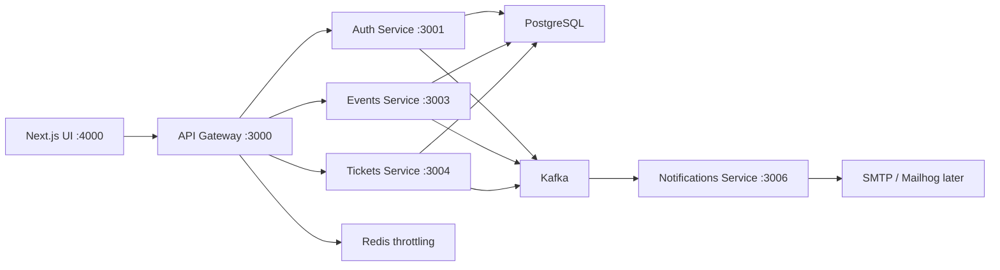

# Evento

Evento is a resume-ready event ticketing platform built with NestJS microservices and a Next.js frontend. It models the core flows of a BookMyShow-style product while keeping the architecture clear enough to explain in an interview.

The product has two primary roles:

- Customers browse published events, see remaining ticket inventory, select quantities, buy tickets, manage their wallet, and cancel eligible tickets.
- Organizers create event listings, publish them for sale, inspect booking manifests, and validate ticket codes at the door.

Kafka is used as the asynchronous event layer for account, ticket, and event notifications. It is intentionally shown as supporting infrastructure instead of being pushed into the customer booking UI.

## Current Status

- Docker artifacts have been removed from the active local workflow for now.
- Product/UI work is focused on the customer and organizer ticketing experience.
- DevOps work such as GitHub Actions, Terraform, Docker, and Kubernetes is intentionally deferred until the product surface is approved.
- Tests are designed to run without Docker so product changes can continue quickly and safely.

## Architecture



## Services

| Service | Responsibility | Port | Main dependencies |
| --- | --- | --- | --- |
| `api-gateway` | Public HTTP entry point, JWT guards, request forwarding | `3000` | Auth/events/tickets services, Redis throttling |
| `auth-service` | Registration, login, JWT issuing, user roles | `3001` | PostgreSQL, Kafka producer |
| `events-service` | Event drafts, publishing, updates, cancellation | `3003` | PostgreSQL, Kafka producer |
| `tickets-service` | Ticket purchase, capacity checks, wallet, cancellation, check-in, event-cancellation ticket orchestration | `3004` | PostgreSQL, Kafka producer/consumer |
| `notifications-service` | Kafka consumers and email notification orchestration | `3006` | Kafka consumer, SMTP/Mailhog later |
| `client` | Next.js customer, organizer, and ops UI | `4000` | API Gateway |

## Frontend Routes

| Route | Purpose |
| --- | --- |
| `/events` | Customer marketplace |
| `/events/:id` | Customer event detail and checkout |
| `/tickets` | Customer ticket wallet |
| `/organizer/events` | Organizer event management |
| `/organizer/check-in` | Organizer ticket validation |
| `/login` | Sign in |
| `/register` | Customer/Organizer signup |
| `/ops` | Admin-only system/Kafka overview |

## Feature Flows

- Register/login with either `USER` or `ORGANIZER` role.
- Organizer signup links preselect the Organizer account type so the create-listing path does not feel generic.
- Organizer sign-in links open organizer-context login copy while real routing still follows the authenticated account role.
- Organizer creates listings with a live publish-readiness preview, updates drafts, publishes, confirms destructive event cancellations, and reviews customer booking manifests with attendee name, email, ticket code, quantity, and booking value.
- Customer browses published events with photographic posters, a featured event, search, organizer-selected category, city/date filters, sorting, remaining-seat urgency, event-detail checkout, multi-ticket booking, and a wallet confirmation handoff after purchase.
- Ticket wallet shows booking confirmation, ticket code, quantity, price, status, and QR-style pass.
- Customer can cancel eligible confirmed tickets after confirming the destructive action.
- Organizer validates ticket codes at check-in.
- Wrong-role organizer routes guide customers back to browsing or their ticket wallet, while signed-out organizer routes point to organizer sign-in/signup.
- Admin-only `/ops` presents the system and Kafka overview without cluttering customer screens.

## API Surface

Public API Gateway routes:

| Method | Route | Purpose |
| --- | --- | --- |
| `POST` | `/auth/register` | Create customer or organizer account |
| `POST` | `/auth/login` | Sign in and receive JWT |
| `GET` | `/auth/profile` | Resolve authenticated profile |
| `GET` | `/events` | List published events |
| `GET` | `/events/:id` | Read event detail |
| `GET` | `/events/my-events` | List organizer-owned events |
| `POST` | `/events` | Create event draft |
| `PUT` | `/events/:id` | Update event |
| `POST` | `/events/:id/publish` | Publish event |
| `POST` | `/events/:id/cancel` | Cancel event |
| `POST` | `/tickets/purchase` | Purchase tickets |
| `GET` | `/tickets/my-tickets` | List customer wallet tickets |
| `GET` | `/tickets/:id` | Read owned ticket |
| `POST` | `/tickets/:id/cancel` | Cancel owned ticket |
| `POST` | `/tickets/check-in` | Organizer ticket validation |
| `GET` | `/tickets/event/:eventId` | Organizer ticket list for an event |

## Kafka Story

Evento emits domain events when important actions happen:

- `user.registered`
- `user.login`
- `event.created`
- `event.published`
- `event.updated`
- `event.cancelled`
- `ticket.purchased`
- `ticket.cancelled`
- `ticket.checked-in`

The strongest notification flows today are:

- User registration sends a welcome email.
- Event publishing sends an organizer confirmation email.
- Ticket purchase enforces remaining capacity and sends an INR ticket confirmation email using real customer, event, venue, and date data.
- Ticket cancellation sends an INR cancellation email using real ticket and event data, with different copy when the organizer cancels the event.
- Ticket check-in sends a check-in confirmation email using real customer, event, venue, and date data.
- Event cancellation sends an organizer notification using real organizer and event data.
- Event cancellation is also consumed by `tickets-service`, which auto-cancels confirmed attendee tickets and emits `ticket.cancelled` notifications for affected customers.

Current caveat: event cancellation auto-cancels confirmed attendee tickets. It does not retroactively undo tickets already marked checked in.

## Local Setup

Install dependencies:

```bash
pnpm install
pnpm -C client install
```

Prepare the database schema when a local PostgreSQL database is available:

```bash
pnpm exec drizzle-kit push
```

Load a repeatable showcase dataset:

```bash
pnpm run seed:showcase
```

This creates customer, organizer, and admin showcase accounts, one published event, and one confirmed wallet ticket. All showcase accounts use password `Evento@123`.

Run services individually during local development:

```bash
pnpm exec nest start api-gateway --watch
pnpm exec nest start auth-service --watch
pnpm exec nest start events-service --watch
pnpm exec nest start tickets-service --watch
pnpm exec nest start notifications-service --watch
pnpm -C client run dev
```

Docker is intentionally absent during the current product-iteration phase. Reintroduce and re-test Docker only after the product/demo surface is approved.

## Quality Gates

Run the full no-Docker verification gate from the repository root:

```bash
pnpm verify
```

Or run the backend and frontend gates separately:

```bash
pnpm run verify:product
pnpm run verify:backend
pnpm run verify:client
```

Current verified coverage includes:

- Product readiness checks for required routes, approval docs, pre-DevOps artifact gating, and starter/incomplete-project UI copy.
- Backend unit/integration-style service tests, including customer/organizer auth role contracts, API Gateway auth forwarding, organizer event ownership for publishing/cancellation, multi-ticket capacity contracts, invalid ticket quantity guards, and organizer manifest authorization.
- No-Docker HTTP contract tests for critical gateway-to-service mutations.
- Explicit service health e2e checks.
- Browser E2E tests for marketplace entry routing, old-route removal, auth entry UX, organizer login context, organizer signup preselection, wrong-role journey recovery, customer/organizer registration, login role routing, sign-out session clearing, customer event-detail checkout, wallet confirmation handoff, wallet cancellation confirmation, organizer event creation with listing preview, organizer publishing, organizer cancellation confirmation, organizer booking manifests with attendee identity, organizer check-in, admin-only ops access, subtle Kafka presentation, and mobile customer/organizer layout checks.

## Demo Walkthrough

Use [docs/PRODUCT-STATUS.md](docs/PRODUCT-STATUS.md) for the current product evidence snapshot and approval gate.
Use [docs/PRODUCT-APPROVAL-PACKET.md](docs/PRODUCT-APPROVAL-PACKET.md) when deciding whether the product is ready for the final DevOps phase.
Use [docs/SHOWCASE-RUNBOOK.md](docs/SHOWCASE-RUNBOOK.md) when rehearsing the live walkthrough and local runtime story.
Use [docs/DEMO-SCRIPT.md](docs/DEMO-SCRIPT.md) for a 5-8 minute interview walkthrough.
Use [docs/INTERVIEW-GUIDE.md](docs/INTERVIEW-GUIDE.md) when you need the deeper explanation, architecture story, Kafka talking points, testing story, and resume bullets.

Short version:

1. Start at `/events` and explain the featured event, poster cards, `Book now` actions, search, category chips, city/date filters, sorting, and remaining-seat urgency.
2. Register as an organizer and create, edit, then publish an event from `/organizer/events`, including venue, city, category, capacity, and price.
3. Register or sign in as a customer, open an event detail page, review the showtime/venue checkout summary, and buy multiple tickets.
4. Open `/tickets` to show the ticket wallet, code, quantity, price, and cancellation rules.
5. Switch back to organizer, inspect the event booking manifest, and use `/organizer/check-in` to validate a ticket code.
6. Mention Kafka in the background: register, publish, purchase, check-in, and cancellation events drive notification and ticket orchestration workflows.
7. End with the testing story and the planned DevOps layer.

## DevOps Roadmap

The final resume layer is intentionally deferred until the product surface is approved:

- Before starting, use [docs/PRODUCT-APPROVAL-CHECKLIST.md](docs/PRODUCT-APPROVAL-CHECKLIST.md) to approve the product/demo surface.
- GitHub Actions CI for backend, frontend, and Playwright gates.
- Dockerfiles and Docker Compose for local full-stack runtime.
- Terraform for infrastructure provisioning.
- Kubernetes manifests or Helm chart for service deployment.
- Observability and release documentation.

## What Not To Claim Yet

- Do not claim live Kafka/Postgres E2E is verified while Docker is absent from the current workflow.
- Do not claim event cancellation reverses tickets already marked checked in.
- Do not claim production-grade payment processing; payment topics are reserved for future work.
